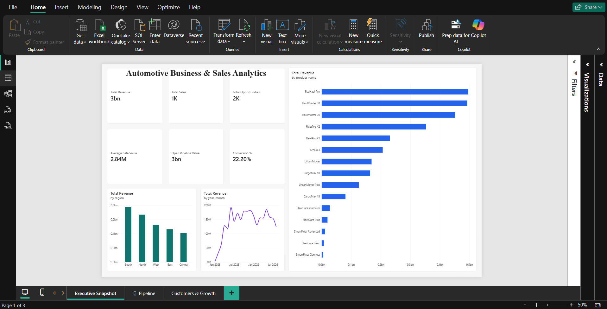
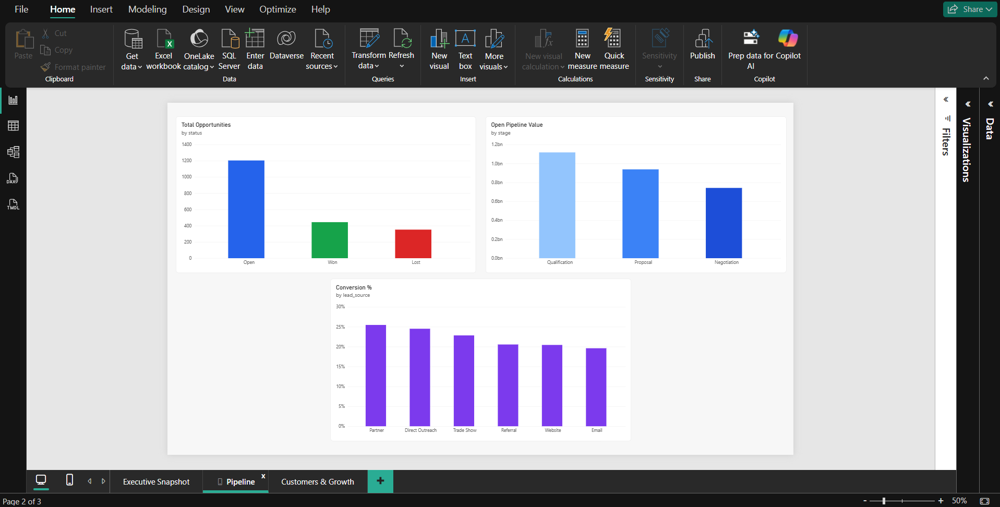
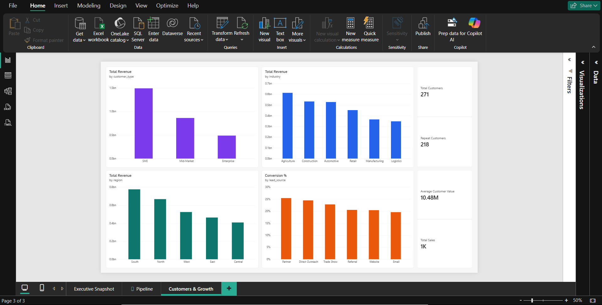

# Automotive Business Growth and Sales Analytics

A business analytics portfolio project exploring sales performance, customer behaviour, product revenue, regional performance, and sales opportunities using Python, SQL, and Power BI.

**Repository:** [automotive-business-growth-sales-analytics](https://github.com/abdulfadhil/automotive-business-growth-sales-analytics)

## About the Project

This project explores how business data can help explain sales performance, customer activity, product contribution, and sales opportunities. It brings together customer records, product information, sales transactions, opportunity data, sales representatives, and synthetic market-segment data.

The project was inspired by business analytics and business development work handled during an internship at Asta Innovations in Chennai in June 2024. It presents a portfolio case study using synthetic data.

The aim is to demonstrate a practical analytics workflow: understanding structured data, validating its quality, analysing business questions with SQL, interpreting results, and preparing data for Power BI reporting.

The source records are synthetic. The results do not represent actual Asta Innovations performance, and the project does not include confidential company or customer records.

## Business Problem

Businesses need a clear view of revenue, regional performance, product contribution, customer activity, and potential revenue in the sales pipeline. Analysing these areas together helps identify patterns that deserve further investigation.

This project explores the following questions:

- Which regions contribute the most revenue?
- Which products generate the most revenue?
- How many sales opportunities become wins?
- How much potential value remains in the open pipeline?
- Which lead sources have higher conversion rates?
- How many customers make repeat purchases?

## Objectives

- Understand the source datasets and their relationships.
- Validate data quality and numerical consistency.
- Analyse revenue by region and product.
- Calculate opportunity conversion and open pipeline value.
- Explore customer activity and repeat purchasing.
- Prepare structured data for Power BI.
- Make the SQL analysis reproducible.
- Document findings, assumptions, and limitations.

## Tools and Technologies

| Technology | Purpose |
|---|---|
| Python | Data validation and analysis workflow |
| Pandas | Working with structured datasets |
| SQL | Business queries and data-quality checks |
| SQLite | Executing SQL against an in-memory database |
| Power BI | Business reporting and visual analysis |
| pytest | Automated data-validation tests |
| Git and GitHub | Version control and project sharing |

## Dataset Overview

The project contains six synthetic source datasets.

| Dataset | Records | Purpose |
|---|---:|---|
| Customers | 500 | Customer details and segmentation |
| Products | 15 | Product names, categories, and prices |
| Sales representatives | 20 | Representative, region, and team information |
| Opportunities | 2,000 | Lead sources, stages, status, and expected value |
| Sales | 1,000 | Transactions, quantities, and revenue |
| Market analysis | 5 | Synthetic market-segment scenario inputs |

See the [Data Dictionary](docs/data_dictionary.md) for column definitions, table descriptions, and relationships.

## Methodology

### 1. Understand the data

Review the source tables, identify key columns, and understand how customers, products, representatives, opportunities, and sales relate to each other.

### 2. Validate data quality

Check missing values, primary-key uniqueness, numerical validity, referential integrity, sales consistency, and revenue calculations.

### 3. Analyse business performance

Use SQL to analyse revenue by region and product, opportunity conversion, open pipeline value by stage, and synthetic market-segment rankings.

### 4. Prepare reporting data

Organise the data into dimension and fact tables for customer, date, product, sales representative, sales, and opportunity analysis.

### 5. Interpret the results

Summarise the metrics and patterns, explain what they suggest, and distinguish observations from assumptions that require additional evidence.

## Key Results

These figures describe the synthetic dataset.

| Metric | Result |
|---|---:|
| Total revenue | ₹2,839,260,000 |
| Sales records | 1,000 |
| Total opportunities | 2,000 |
| Won opportunities | 444 |
| Opportunity conversion rate | 22.20% |
| Open pipeline value | ₹2,797,135,758 |
| Total customers | 500 |
| Customers with sales | 271 |
| Repeat customers | 218 |
| Average customer value | ₹10,476,974 |

### Selected Findings

- **Regional performance:** South contributes 27.33% of total revenue.
- **Product performance:** EcoHaul Pro contributes 17.47% of total revenue.
- **Lead-source performance:** Partner leads have a 25.47% conversion rate, the highest among the lead sources in the dataset.
- **Customer behaviour:** 271 customers have recorded sales, and 218 are repeat customers.

These are descriptive findings from synthetic data, not actual company performance or verified market trends.

Read the [Business Insights](reports/business_insights.md) document for further interpretation.

## SQL Analysis

The SQL analysis covers five business questions:

1. Revenue by region.
2. Revenue by product and category.
3. Opportunity conversion rate.
4. Open pipeline value by stage.
5. Ranking of synthetic market segments.

Run the analysis from the repository root:

```bash
python scripts/run_sql_analysis.py
```

The runner loads the CSV files into an in-memory SQLite database, applies the SQL schema, executes five business-analysis queries, and performs ten data-quality checks. It does not create a persistent database file or modify the source CSV files.

## Data Validation

The automated Python tests cover source files, missing values, primary-key uniqueness, numerical validity, referential integrity, sales consistency, revenue calculations, Power BI-ready tables, and date coverage.

**Recorded Python test result: 10 of 10 tests passed.**

The SQL runner also completed ten data-quality checks with zero reported violations.

Run the tests from the repository root:

```bash
python -m pytest -q
```

See the [Validation Report](docs/validation_report.md) for the validation scope and results.

## Power BI Report

The repository includes the Power BI report:

[`dashboard/automotive-business-growth-sales-analytics.pbix`](dashboard/automotive-business-growth-sales-analytics.pbix)

The report is documented around three business areas:

- **Executive Snapshot:** business performance and KPIs.
- **Pipeline:** opportunity stages, conversion, and open pipeline value.
- **Customers & Growth:** customer activity and growth-related analysis.

The [Power BI Data Model](dashboard/powerbi_model.md) describes the intended tables, relationships, and KPI definitions. The documentation does not independently verify every visual, measure, or interaction in Power BI Desktop.

### Screenshots and Demo

The Power BI report contains three pages covering overall business performance, sales pipeline performance, and customer growth.

#### 1. Executive Snapshot



#### 2. Pipeline Analysis



#### 3. Customers & Growth



*Note: The project uses synthetic data for demonstration and portfolio purposes.*

## Repository Structure

| Path | Purpose |
|---|---|
| `data/raw/` | Synthetic source datasets |
| `python/` | Notebook-based analysis |
| `sql/` | SQL schema and analytical queries |
| `scripts/` | Reproducible SQL runner |
| `tests/` | Automated data-quality tests |
| `dashboard/` | Power BI report and model documentation |
| `docs/` | Data dictionary and validation report |
| `reports/` | Business insights and KPI summary |

Refer to the repository tree for the complete file inventory.

## Getting Started

### Requirements

- Python installed.
- A local copy of the repository.
- The project's required Python dependencies.

### Create a virtual environment

```bash
python -m venv .venv
```

Activate it in Windows PowerShell:

```powershell
.\.venv\Scripts\Activate.ps1
```

Install the required dependencies:

```bash
python -m pip install -r requirements.txt
```

Then run the Python tests and SQL analysis using the commands above.

## Limitations and Transparency

- All source records are synthetic.
- Market-analysis values are scenario inputs, not independently verified external research.
- The findings describe the supplied dataset and do not establish real-world causation.
- The results should not be interpreted as actual company performance or forecasts.
- The intended Power BI model and report pages should be checked in Power BI Desktop before claiming that every visual and interaction has been verified.

## Project Documentation

- [Data Dictionary](docs/data_dictionary.md)
- [Validation Report](docs/validation_report.md)
- [Business Insights](reports/business_insights.md)
- [Power BI Data Model](dashboard/powerbi_model.md)

## License

This project is licensed under the MIT License. See [LICENSE](LICENSE) for the terms.

---

**Project:** Automotive Business Growth and Sales Analytics
**Repository:** [github.com/abdulfadhil/automotive-business-growth-sales-analytics](https://github.com/abdulfadhil/automotive-business-growth-sales-analytics)
